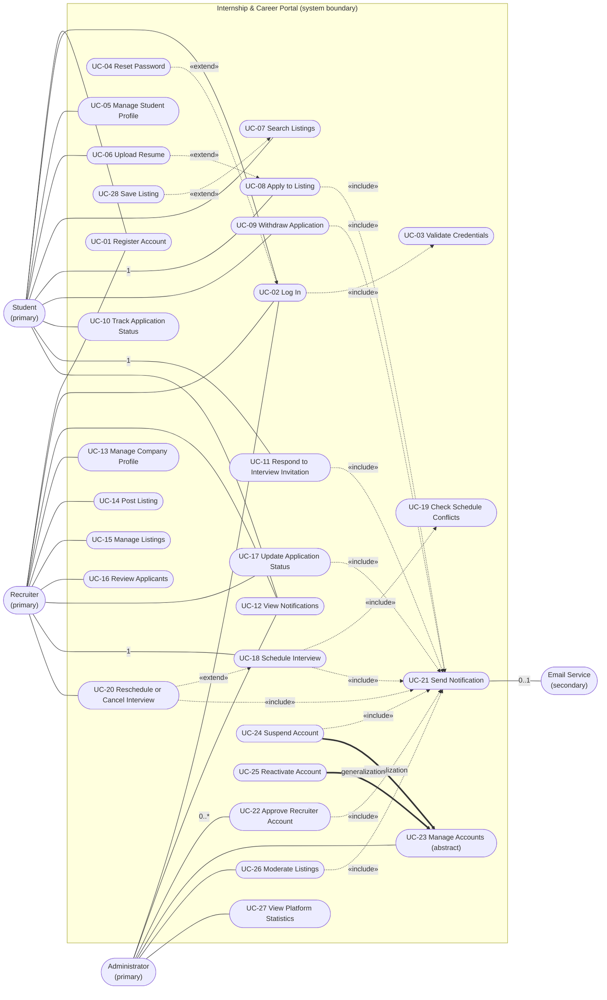
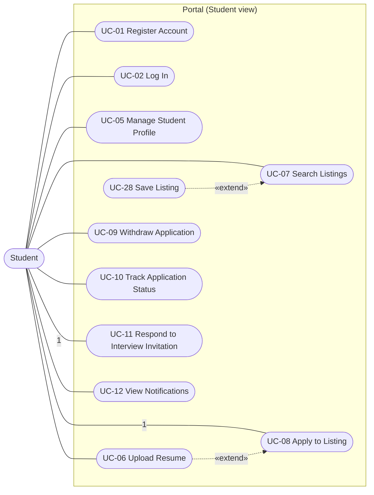
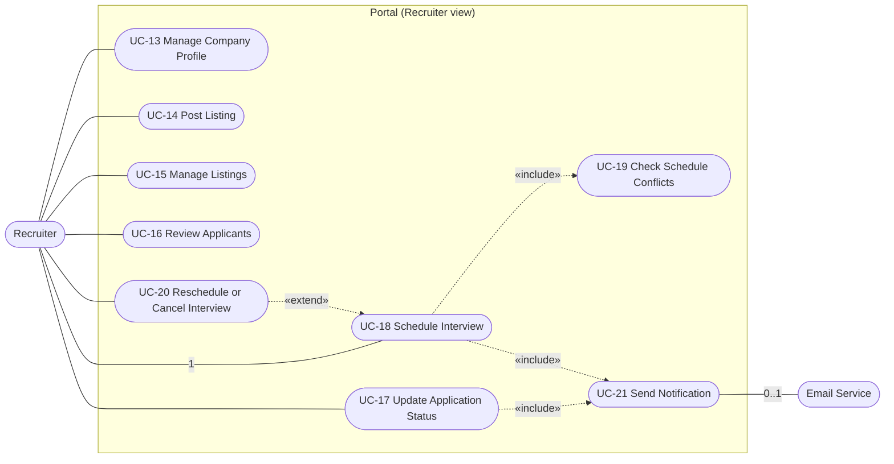
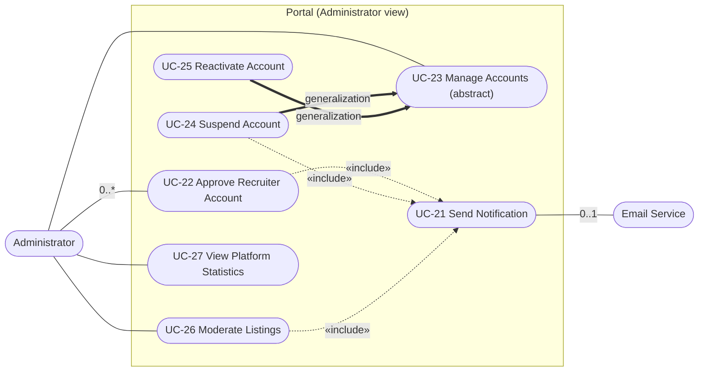
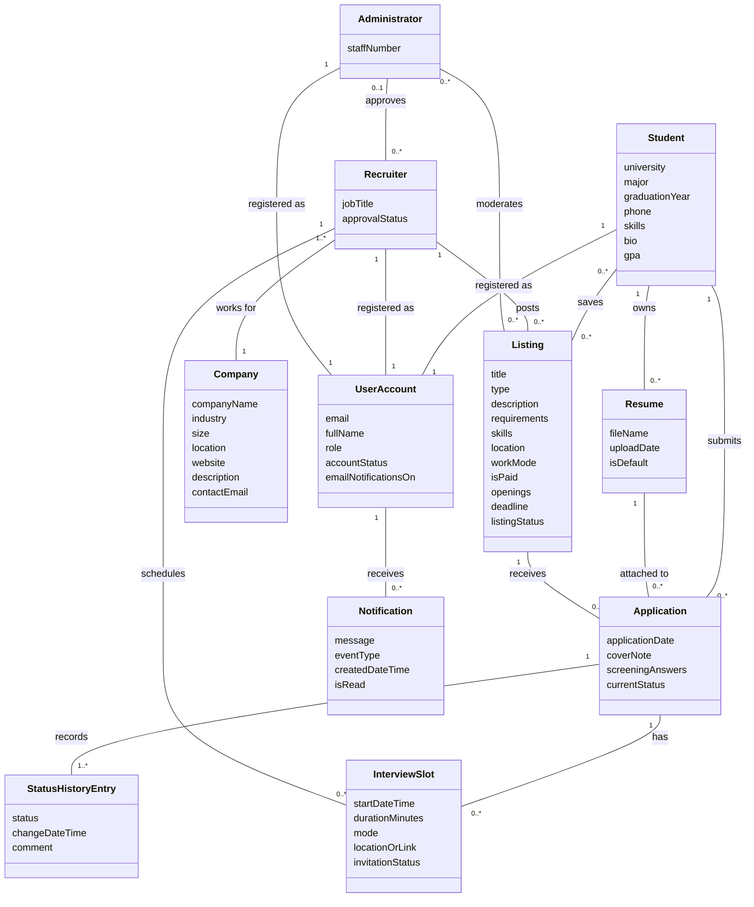

<div align="center">

&nbsp;

**Zewail City of Science, Technology and Innovation**

**University of Science and Technology**

**School of Computational Sciences and Artificial Intelligence**

&nbsp;

**CSAI 203 – Fall 2026**

**Introduction to Software Engineering**

&nbsp;

# Internship & Career Portal

## Software Requirements Specification (SRS)

&nbsp;

**Team Number:** 000_Z

**Team Members:**

| Name | ID |
|:---:|:---:|
| Marawan_Abdulrahim | 202402293 |
| Rabie_Alsayed | 202400113 |
| Nezar_Muhammad | 202400953 |

&nbsp;

**Representative Contact Info:** s-marawan.elbalal@zewailcity.edu.eg 

&nbsp;

**Date:** 23 October 2026

</div>

<div style="page-break-after: always;"></div>

---

# Document Control

| Item | Detail |
|---|---|
| **Document** | Software Requirements Specification (SRS) |
| **Project** | Internship & Career Portal |
| **File name** | `CSAI203_SRS_Team_0Z_202402293` |
| **Course** | CSAI 203 – Introduction to Software Engineering, Fall 2026 |
| **Version** | 1.0 (baseline) |
| **Status** | Submitted for review |
| **Date** | 23 October 2026 |

## Revision History

| Version | Date | Description | Author |
|---|---|---|---|
| 0.1 | 5 Oct 2026 | Feasibility check and stakeholder identification | Team 0Z |
| 0.5 | 21 Oct 2026 | Elicitation results analysed; use case model and conceptual class diagram drafted | Team 0Z |
| 1.0 | 23 Oct 2026 | Complete SRS baseline | Team 0Z |

## Table of Contents

1. [Introduction](#1-introduction)
   1. [Purpose](#11-purpose)
   2. [Scope](#12-scope)
   3. [Definitions, Acronyms, and Abbreviations](#13-definitions-acronyms-and-abbreviations)
   4. [References](#14-references)
   5. [Overview](#15-overview)
2. [Overall Description](#2-overall-description)
   1. [Product Perspective](#21-product-perspective)
   2. [Product Functions](#22-product-functions)
   3. [User Classes and Characteristics](#23-user-classes-and-characteristics)
   4. [Operating Environment](#24-operating-environment)
   5. [Design and Implementation Constraints](#25-design-and-implementation-constraints)
   6. [User Documentation](#26-user-documentation)
   7. [Assumptions and Dependencies](#27-assumptions-and-dependencies)
3. [Specific Requirements](#3-specific-requirements)
   1. [Functional Requirements](#31-functional-requirements)
   2. [Use Case Model](#32-use-case-model)
   3. [Domain Model](#33-domain-model)
   4. [Non-Functional Requirements](#34-non-functional-requirements)
   5. [External Interface Requirements](#35-external-interface-requirements)
4. [Appendices](#4-appendices)
   - [Appendix A: Data Dictionary](#appendix-a-data-dictionary)
   - [Appendix B: Glossary](#appendix-b-glossary)
   - [Appendix C: Requirements Traceability Matrix](#appendix-c-requirements-traceability-matrix)
   - [Appendix D: Feasibility Summary](#appendix-d-feasibility-summary)
   - [Appendix E: Requirements Management and Change Control](#appendix-e-requirements-management-and-change-control)

---

# 1. Introduction

## 1.1 Purpose

This document is the **Software Requirements Specification (SRS)** for the **Internship & Career Portal**, a mini job board that connects students with recruiters. It records the functionality, services, and constraints of the system, so that:

- **Developers** know what is considered complete and what to build;
- **Testers** know what to test and how to judge pass or fail;
- **Instructors and teaching assistants** can evaluate the specification against the course requirements;
- **Project managers** can estimate cost and schedule and track the plan;
- **Future teams** can use it as the baseline for the evolution of the product (for example, a version 2).

**Intended audience:** the development team, the testers, the course instructors and teaching assistants, and the stakeholders listed in Section 2.3.

## 1.2 Scope

**Product name:** Internship & Career Portal ("the Portal").

**What the Portal does.** The Portal is a web-based system with three main user roles:

- **Students** create a profile, upload resumes, search and filter internship and job listings, submit applications, **track the status** of each application, and respond to interview invitations.
- **Recruiters (employers)** create a company profile, **post listings**, review applicants, **update application status**, and **manage interview schedules**.
- **Administrators** approve recruiter accounts, moderate users and listings, and view platform statistics.

The Portal also sends in-app and e-mail notifications when something changes (for example, a new status or a scheduled interview).

**Goals and benefits.**

| Goal | Benefit |
|---|---|
| Put listings and applications in one place | Students no longer search across scattered sources, and recruiters receive applications in a structured form |
| Make the application status visible | Students always know where each application stands |
| Give recruiters scheduling support | Fewer scheduling conflicts and missed interviews |
| Moderate accounts and listings | A safer, more trustworthy job board |

**Out of scope (version 1.0).**

- Online payments or paid premium listings.
- Hosting video interviews inside the Portal (interviews may carry an external meeting link or a physical location).
- Automated resume building or AI-based job matching.
- Native mobile applications (the web interface is responsive instead).
- Salary negotiation and contract signing.

## 1.3 Definitions, Acronyms, and Abbreviations

| Term | Definition |
|---|---|
| **SRS** | Software Requirements Specification |
| **Student** | A registered user seeking an internship or job |
| **Recruiter** | A registered user representing a company, who posts listings and manages applicants |
| **Administrator** | A privileged user who manages accounts, listings, and reports |
| **Listing** | A posted internship or job opening |
| **Application** | A student's submission to a listing, including the chosen resume and any answers |
| **Application Status** | The current stage of an application (see Appendix A) |
| **Status History** | The ordered record of all status changes of an application |
| **Interview Slot** | A scheduled date, time, and duration for an interview |
| **Notification** | An in-app message, optionally also sent by e-mail |
| **Actor** | A role (person, group, or external system) that interacts with the Portal |
| **Use case** | A function or goal the system provides to an actor |
| **Functional requirement (FR)** | A service or function the system must provide ("what") |
| **Non-functional requirement (NFR)** | A constraint or quality attribute describing "how well" the system performs |
| **UML** | Unified Modeling Language |
| **HTTP / HTTPS** | HyperText Transfer Protocol / its encrypted version (ports 80 / 443) |
| **SaaS** | Software as a Service: all functionality runs on the vendor's servers and is accessed through a browser |
| **SMTP** | Simple Mail Transfer Protocol |
| **UI** | User Interface |
| **CRUD** | Create, read, update, delete |

## 1.4 References

1. CSAI 203 – Introduction to Software Engineering, Lectures 1–5 (Dr. Mohamed Sami Rakha), Zewail City of Science, Technology and Innovation: SRS template and benefits (Lecture 4), requirements types and non-functional requirement attributes (Lecture 4), requirements elicitation and analysis, use-case modeling and conceptual class diagrams (Lecture 5), software process models and web basics (Lecture 3).
2. I. Sommerville, *Software Engineering*, 10th Edition (course textbook).
3. I. Sommerville, *Engineering Software Products: An Introduction to Modern Software Engineering*, Pearson, 2019 (course reference).

## 1.5 Overview

- **Section 2** describes the product in general terms: its context, the main functions, the user classes, the environment, the constraints, and the assumptions.
- **Section 3** gives the specific requirements: the functional requirements (3.1), the use case model (3.2), the domain model as a conceptual class diagram (3.3), the non-functional requirements (3.4), and the external interface requirements (3.5).
- **Section 4** contains the appendices: data dictionary, glossary, traceability matrix, feasibility summary, and change-control procedure.

**Conventions used in this document.**

- Requirements are written with **"shall"** (mandatory). Each has a unique ID: **UR-xx** (user requirement), **FR-xx** (functional system requirement), **NFR-xx** (non-functional requirement), **UC-xx** (use case).
- **Priority:** **High** (essential for version 1.0), **Medium** (important), **Low** (desirable).
- Every requirement has an **acceptance criterion** so that a tester can verify it.

---

# 2. Overall Description

## 2.1 Product Perspective

The Portal is a **new, self-contained product**. It is developed in a **product-based** way: the team itself decides the features, because there is no external client who owns and pays for the requirements (as in a student project). Its target customer segment is the university community: students looking for internships and jobs, and the companies that want to hire them.

**Execution model.** The Portal is **service-based (SaaS)**: all functionality and data reside on the Portal's servers, and users access it through a browser. Nothing except the user interface runs on the user's computer.

**System context.**

```text
                                   ┌─────────────────────────────┐
   Student ───── browser ─────────►│                             │
                                   │                             │──── SMTP / e-mail API ───► Email Service
   Recruiter ─── browser ─────────►│   INTERNSHIP & CAREER       │                            (secondary actor)
                                   │          PORTAL             │
   Administrator ─ browser ───────►│   (web application + DB)    │
                                   │                             │
                                   └─────────────────────────────┘
                                         HTTPS (port 443)
```

**Main external element:** an **Email Service** (outbound e-mail) used to deliver notifications. All other behavior is internal to the Portal.

## 2.2 Product Functions

The following **user requirements** (high-level, in natural language, written for customers and users) summarize what the Portal shall let each role do. Each is refined into detailed **system requirements** (FR-xx) in Section 3.1.

| ID | User requirement | Refined by |
|---|---|---|
| **UR-01** | Users shall be able to create an account and log in securely, and only see the functions of their own role. | FR-01 – FR-05 |
| **UR-02** | Students shall be able to maintain a profile and upload resumes. | FR-06, FR-07 |
| **UR-03** | Students shall be able to find relevant listings by searching and filtering. | FR-08 – FR-11 |
| **UR-04** | Students shall be able to apply to listings and withdraw an application. | FR-12 – FR-15 |
| **UR-05** | Students shall be able to track the status of every application. | FR-16 |
| **UR-06** | Students shall be able to respond to interview invitations. | FR-17, FR-18 |
| **UR-07** | Users shall be notified about important events. | FR-19, FR-32, FR-33 |
| **UR-08** | Recruiters shall be able to maintain a company profile and post and manage listings. | FR-20 – FR-23 |
| **UR-09** | Recruiters shall be able to review applicants. | FR-24, FR-25, FR-28 |
| **UR-10** | Recruiters shall be able to update the status of applications. | FR-26, FR-27 |
| **UR-11** | Recruiters shall be able to manage interview schedules without conflicts. | FR-29 – FR-31 |
| **UR-12** | Administrators shall be able to approve recruiters and manage accounts. | FR-34, FR-35 |
| **UR-13** | Administrators shall be able to moderate listings and see platform statistics. | FR-36, FR-37 |
| **UR-14** | The Portal shall be fast, secure, available, reliable, and easy to use. | NFR-01 – NFR-15 |

**Example of refinement (user → system requirement).** UR-05 *"Students shall be able to track the status of every application"* becomes FR-16: *"The system shall display each application's current status and its complete status history (status, date and time, and recruiter comment) on the 'My Applications' page."*

## 2.3 User Classes and Characteristics

### Actors

| Actor | Type | Description | Technical expertise | Frequency of use |
|---|---|---|---|---|
| **Student** | Primary | University student seeking internships or jobs | Basic web skills | Several times a week |
| **Recruiter** | Primary | Employer representative who posts listings and manages applicants and interviews | Basic web skills | Daily during hiring periods |
| **Administrator** | Primary | Career-services or platform staff who approve and moderate | Moderate | Daily |
| **Email Service** | Secondary | External system that delivers e-mail; it only assists the Portal and never starts a use case | n/a | Continuous |

Actors are **roles**. One person may hold several roles (for example, a person could register as a student and, separately, as a recruiter account).

### Stakeholders

| Stakeholder | Interest in the system |
|---|---|
| **Students** | Find opportunities, apply easily, know their status |
| **Recruiters / employers** | Receive qualified applicants and organize interviews efficiently |
| **Administrators / career-services staff** | Trustworthy listings, controlled access, usage statistics |
| **Development team** | Clear, testable requirements |
| **Testers** | Verifiable requirements and acceptance criteria |
| **Course instructors and TAs** | Specification quality and course alignment |
| **University IT staff** | Hosting, security, and maintainability |
| **Privacy and compliance reviewers** | Lawful and ethical handling of personal data |

*Not every stakeholder is an actor: for example, privacy reviewers have a legitimate interest but do not interact with the Portal directly.*

## 2.4 Operating Environment

| Aspect | Specification |
|---|---|
| **Client side** | Modern web browsers (latest two versions of Chrome, Edge, Firefox, and Safari) on desktop, tablet, or phone |
| **Server side** | A web application hosted on a Linux server or cloud virtual machine behind a web server that handles HTTP and HTTPS |
| **Front end** | HTML, CSS, and JavaScript |
| **Back end and database** | A server-side application with a relational database (the design phase will finalize the exact technologies; for example, a Python back end such as Flask and MySQL are possible choices) |
| **Network** | Internet access using HTTPS |
| **External service** | E-mail delivery via SMTP or an e-mail API |

## 2.5 Design and Implementation Constraints

| ID | Constraint |
|---|---|
| **C-01** | The Portal shall be delivered as a **web application** (service-based execution model). |
| **C-02** | All traffic shall use **HTTPS**; plain HTTP requests shall be redirected. |
| **C-03** | Source code shall be managed with **Git** in a shared remote repository (for example, GitHub), using branches for features and fixes, small related commits, and meaningful commit messages. |
| **C-04** | Secrets (such as database passwords) shall be kept in **environment variables**, never in source code. |
| **C-05** | The project shall be completed within the Fall 2026 semester schedule with the available team members. |
| **C-06** | The development process shall be a **blend**: requirements and architecture planned up front (Waterfall-like), features built in **increments** (Incremental), and common services such as e-mail, authentication helpers, and file handling **reused** from existing libraries (Integration and Configuration). |
| **C-07** | Personal data shall be handled according to applicable data-protection rules (see NFR-15). |
| **C-08** | Uploaded files are limited to PDF and DOCX, maximum 5 MB each. |

## 2.6 User Documentation

| Deliverable | Audience | Content |
|---|---|---|
| **Quick-start guide** | Students and recruiters | Registering, logging in, and the main tasks step by step |
| **Online help and FAQ** | All users | Answers to common questions (for example, "What do the statuses mean?") |
| **Administrator guide** | Administrators | Approving recruiters, moderating listings, reading reports |
| **In-context tooltips and messages** | All users | Short hints and clear error messages in the interface |
| **Technical README** | Developers and testers | Setup, configuration (environment variables), deployment steps |

## 2.7 Assumptions and Dependencies

### Assumptions

| ID | Assumption |
|---|---|
| **A-01** | Users have a modern browser and a stable internet connection. |
| **A-02** | Recruiters supply truthful company information; the Administrator verifies it during approval. |
| **A-03** | Students are the owners of the data they provide and consent to its use for applications. |
| **A-04** | A listing has exactly one owning recruiter, and a student may apply to a listing at most once at a time. |
| **A-05** | Interviews are conducted outside the Portal; the Portal only stores the schedule, mode (on-site or online), and location or meeting link. |
| **A-06** | The Portal's time zone is a single configured time zone (Cairo time) in version 1.0. |
| **A-07** | The Portal does not guarantee that recruiters will respond within any time frame. |

### Dependencies

| ID | Dependency |
|---|---|
| **D-01** | An **e-mail delivery service** is available (if it is down, in-app notifications still work). |
| **D-02** | A **domain name**, DNS configuration, and an HTTPS certificate are available for deployment. |
| **D-03** | A hosting provider (server or cloud) with enough capacity is available. |
| **D-04** | A shared Git repository service is available for the team. |


---

# 3. Specific Requirements

This section refines the user requirements (UR-xx) of Section 2.2 into detailed, testable **system requirements**. Every requirement has a unique ID, a priority, and an **acceptance criterion** (AC) so a tester can decide pass or fail. Status values and field rules are defined in **Appendix A**.

## 3.1 Functional Requirements

Functional requirements describe **what** the Portal does. Priority: **H** = High, **M** = Medium, **L** = Low.

### 3.1.1 Accounts and Access (UR-01)

| ID | Requirement | Pri. | Acceptance criterion |
|---|---|---|---|
| **FR-01** | The system shall let a visitor **register** as a Student or a Recruiter by providing full name, e-mail address, password, and role. The e-mail address shall be unique. Student accounts shall be activated after e-mail verification; Recruiter accounts shall start as *Pending Approval* (see FR-34). | H | Registering with an unused e-mail creates an account and sends a verification message; registering with an existing e-mail is rejected with a clear message; a password shorter than 8 characters or without a letter and a digit is rejected. |
| **FR-02** | The system shall **authenticate** users by e-mail and password and open the dashboard of their role. After **5 consecutive failed attempts** the account shall be locked for 15 minutes. | H | Valid credentials open the correct dashboard; invalid credentials show a generic error that does not reveal whether the e-mail exists; the 6th attempt within the lock period is refused even with the correct password. |
| **FR-03** | The system shall let users **log out** and shall end a session after **30 minutes of inactivity**. | H | After logout, the browser "Back" button does not show protected pages; a session idle for 30 minutes requires login again. |
| **FR-04** | The system shall let a user **reset a forgotten password** through a one-time link sent by e-mail, valid for **60 minutes** and usable once. | M | A used or expired link is refused; after a successful reset the old password no longer works. |
| **FR-05** | The system shall enforce **role-based access control**: a user shall only see and execute the functions of their own role, and a recruiter who is not yet approved or an account that is suspended shall not post listings or log in respectively. | H | Requesting an administrator page as a Student returns "403 Forbidden" and the attempt is logged; a *Pending Approval* recruiter cannot reach "Post Listing". |

### 3.1.2 Student Profile and Resumes (UR-02)

| ID | Requirement | Pri. | Acceptance criterion |
|---|---|---|---|
| **FR-06** | The system shall let a student **create and edit a profile**: full name, university, major, expected graduation year, phone, skills, short bio, and optional GPA. | H | Saved changes are visible on the next page load; invalid values (e.g., graduation year in the distant past, non-numeric GPA) are rejected with a field-level message. |
| **FR-07** | The system shall let a student **upload, list, set as default, and delete resumes** (maximum **5** per student; **PDF or DOCX only; ≤ 5 MB each**, see C-08). | H | A 4.9 MB PDF is accepted; a 5.1 MB file, a `.exe`, or a sixth resume is rejected with an explanation; deleting a resume does not alter resumes already attached to submitted applications (FR-14). |

### 3.1.3 Finding Listings (UR-03)

| ID | Requirement | Pri. | Acceptance criterion |
|---|---|---|---|
| **FR-08** | The system shall let a student **search listings by keyword** in title, company name, and required skills. | H | Searching "data analyst" returns every open listing containing those words in the three fields and no unrelated listing; an empty result shows a "no results" message. |
| **FR-09** | The system shall let a student **filter** listings by type (internship / job), location, field, work mode (on-site / remote / hybrid), paid or unpaid, and application deadline; filters shall be combinable with the keyword search. | H | Selecting *Internship + Remote + Paid* returns only listings matching all three; clearing filters restores the full list. |
| **FR-10** | The system shall **display only open, non-removed listings** to students, show listing details, **sort** by newest or nearest deadline, and **paginate** results (10 per page). | H | A closed, expired, or removed listing never appears in results; sorting by deadline orders results ascending; page 2 shows items 11–20. |
| **FR-11** | The system shall let a student **save (bookmark) a listing** and view or remove saved listings. | L | A saved listing appears in "Saved Listings" after logout and login; removing it deletes it from the list. |

### 3.1.4 Applying and Tracking (UR-04, UR-05)

| ID | Requirement | Pri. | Acceptance criterion |
|---|---|---|---|
| **FR-12** | The system shall let a student **apply** to an open listing by choosing one of their resumes and optionally adding a cover note (≤ 1,000 characters) and answers to listing questions. | H | The application is created with status *Submitted* and the first status-history entry (date, time, "Submitted") is stored. |
| **FR-13** | The system shall **prevent invalid applications**: after the deadline, to a closed or removed listing, with an incomplete profile (full name, university, major, graduation year), or when the student already has an **active** application to the same listing (A-04). | H | Each of the four cases is refused with a specific message and no application record is created. |
| **FR-14** | The system shall show an **on-screen confirmation** after applying and shall keep an **unchangeable copy (snapshot) of the chosen resume** with the application. | M | Replacing or deleting the resume in the profile later does not change the file the recruiter sees for that application. |
| **FR-15** | The system shall let a student **withdraw** an application that is not already *Rejected* or *Withdrawn*. The status becomes *Withdrawn*, and the student may re-apply later if the listing is still open. | M | After withdrawal, the recruiter's list shows *Withdrawn*; the student can submit a new application to the same open listing. |
| **FR-16** | The system shall display, on the "My Applications" page, each application's **current status and its complete status history** (status, date and time, and recruiter comment). | H | After a recruiter changes a status, the student sees the new status and the history entry within 60 seconds; entries are listed in chronological order and cannot be edited by the student. |

### 3.1.5 Interview Invitations — Student Side (UR-06)

| ID | Requirement | Pri. | Acceptance criterion |
|---|---|---|---|
| **FR-17** | The system shall show a student every **interview invitation** with date, time, duration, mode (on-site or online), and location or meeting link. | H | An invitation created by a recruiter appears in the student's "Interviews" page with all six fields. |
| **FR-18** | The system shall let a student **accept, decline, or request rescheduling** (with a comment) for each invitation, and shall inform the recruiter of the response. | H | The invitation status changes to *Accepted*, *Declined*, or *Reschedule Requested*; the recruiter receives a notification (FR-32). |

### 3.1.6 Notifications — User Side (UR-07)

| ID | Requirement | Pri. | Acceptance criterion |
|---|---|---|---|
| **FR-19** | The system shall provide an **in-app notification center** listing a user's notifications (newest first), an **unread counter**, and the ability to mark notifications as read. Notifications shall be kept for **90 days**. | H | A new notification increments the counter; opening it marks it read and decrements the counter; notifications older than 90 days are no longer listed. |

### 3.1.7 Recruiter: Company and Listings (UR-08)

| ID | Requirement | Pri. | Acceptance criterion |
|---|---|---|---|
| **FR-20** | The system shall let a recruiter **create and edit a company profile**: company name, industry, size, location, website, description, and contact e-mail. | H | The company name and description appear on every listing of that recruiter. |
| **FR-21** | The system shall let an **approved** recruiter **post a listing** with title, type, description, requirements, required skills, location, work mode, paid/unpaid, number of openings, deadline (future date), and optional screening questions. The listing is published immediately and is subject to later moderation (FR-36). | H | A valid listing appears in student search within 1 minute; a past deadline or a missing mandatory field is rejected. |
| **FR-22** | The system shall let a recruiter **edit, close, and reopen** own listings. Editing shall not change applications already submitted; a closed listing shall accept no new applications. | H | After closing, "Apply" is disabled; existing applications remain visible to the recruiter. |
| **FR-23** | The system shall let a recruiter **view own listings** with status and number of applicants, and **delete** a listing only if it has no applications (otherwise it can only be closed). | M | Deleting a listing with 3 applications is refused with an explanation; deleting an empty listing removes it. |

### 3.1.8 Recruiter: Reviewing and Status (UR-09, UR-10)

| ID | Requirement | Pri. | Acceptance criterion |
|---|---|---|---|
| **FR-24** | The system shall let a recruiter **view the list of applicants** of each own listing (name, university, major, date applied, status). | H | A recruiter sees applicants only for own listings; opening another recruiter's listing returns "403 Forbidden". |
| **FR-25** | The system shall let a recruiter **open an application** to see the student's profile, the submitted resume (download), the cover note, and screening answers. | H | The resume snapshot downloads in its original format and opens correctly. |
| **FR-26** | The system shall let a recruiter **change the status** of an application only along the **allowed transitions** defined in Appendix A (Table A-1). | H | Changing *Submitted* directly to *Offer Made* is refused; changing *Submitted* to *Under Review* succeeds. |
| **FR-27** | The system shall let a recruiter add an optional **comment** to a status change (required when choosing *Rejected*), shall record it with the **date, time, and recruiter** in the status history, and shall never delete history entries. | H | A *Rejected* change without a comment is refused; every change creates exactly one history entry visible to the student (FR-16). |
| **FR-28** | The system shall let a recruiter **filter and sort applicants** by status, application date, and keyword (name or skill). | M | Filtering by *Shortlisted* shows only shortlisted applicants; sorting by date orders them correctly. |

### 3.1.9 Recruiter: Interviews (UR-11)

| ID | Requirement | Pri. | Acceptance criterion |
|---|---|---|---|
| **FR-29** | The system shall let a recruiter **create an interview slot** for an application in status *Shortlisted* or later: date (in the future), start time, duration (15–180 min), mode, and location or meeting link. Creating the slot sets the application to *Interview Scheduled* and sends an invitation. | H | The slot appears in both the recruiter's and the student's interview lists; a past date is refused. |
| **FR-30** | The system shall **detect scheduling conflicts**: it shall refuse a slot that overlaps another slot of the same recruiter or another slot of the same student, and shall tell the recruiter that a conflict exists (without revealing details of other companies' interviews). | H | Creating a slot 10:00–11:00 when 10:30–11:30 exists for the same recruiter is refused; the same holds when the student already has an overlapping slot. |
| **FR-31** | The system shall let a recruiter **reschedule or cancel** a slot and shall show the recruiter's upcoming interviews in a chronological list. A cancelled slot returns the application to *Shortlisted*. | M | After rescheduling, the student sees the new time and gets a notification; after cancellation the status is *Shortlisted* again. |

### 3.1.10 Notification Delivery (UR-07)

| ID | Requirement | Pri. | Acceptance criterion |
|---|---|---|---|
| **FR-32** | The system shall create an **in-app notification** for each of these events: new application (to recruiter), status change (to student), application withdrawn (to recruiter), interview created / rescheduled / cancelled (to student), interview response (to recruiter), recruiter approved or rejected (to recruiter), listing removed or restored (to recruiter), and account suspended or reactivated (to user). | H | Each listed event produces exactly one notification to the correct recipient within 10 seconds. |
| **FR-33** | The system shall also send an **e-mail** for the events of FR-32 through the Email Service. A failed delivery shall be **retried up to 3 times at 5-minute intervals** and then logged; the in-app notification shall not depend on e-mail success (D-01). Users may switch off e-mail for non-security events. | H | With the Email Service stopped, the in-app notification still appears and 3 retries are logged; with e-mail switched off, no e-mail is sent but the in-app notification remains. |

### 3.1.11 Administration (UR-12, UR-13)

| ID | Requirement | Pri. | Acceptance criterion |
|---|---|---|---|
| **FR-34** | The system shall let an administrator **review pending recruiter accounts** (company and contact details) and **approve or reject** each one; a rejection requires a reason. The recruiter is notified of the decision. | H | An approved recruiter can post listings immediately; a rejected recruiter cannot log in to recruiter functions and sees the reason. |
| **FR-35** | The system shall let an administrator **search accounts and suspend or reactivate** them. A suspended user cannot log in. An administrator cannot suspend their own account. Each action shall be recorded in an audit log (who, what, when). | H | A suspended account's login is refused with a "suspended" message; the audit log shows the action; suspending one's own account is refused. |
| **FR-36** | The system shall let an administrator **view all listings** and **remove or restore** a listing with a reason. A removed listing is hidden from students; its applications remain stored. The recruiter is notified. | H | A removed listing disappears from student search immediately and reappears after restoration. |
| **FR-37** | The system shall show an administrator **platform statistics**: users by role, active listings, applications by status, interviews scheduled, and applications per listing, for a selectable date range, with **CSV export**. | M | The totals equal the counts in the database for the chosen range; the exported CSV opens in a spreadsheet with the same figures. |

## 3.2 Use Case Model

The system is treated as a **black box**; the boundary is the Portal. **Actors** (Section 2.3) are placed outside the boundary. A use case is always initiated by an actor, delivers value, and is connected to at least one actor; the **Email Service** is a **secondary actor** and never starts a use case.

### 3.2.1 Use Case Diagrams

**Notation.** Solid line = association. Dashed arrow labelled «include» points **from the base use case to the included one**. Dashed arrow labelled «extend» points **from the extending use case to the base one**. Thick arrow labelled *generalization* points from the specialized use case to the general one. Numbers on lines are multiplicities.

#### Diagram 1 — Overall system-level diagram



#### Diagram 2 — Student view



#### Diagram 3 — Recruiter view



#### Diagram 4 — Administrator view



### 3.2.2 Actor–Use Case Summary

| Actor | Type | Use cases |
|---|---|---|
| **Student** | Primary | UC-01, 02, 04, 05, 06, 07, 08, 09, 10, 11, 12, 28 |
| **Recruiter** | Primary | UC-01, 02, 04, 12, 13, 14, 15, 16, 17, 18, 20 |
| **Administrator** | Primary | UC-02, 12, 22, 23 (24, 25), 26, 27 |
| **Email Service** | Secondary | UC-21 (responds to or assists; never initiates) |

### 3.2.3 Relationships and Multiplicity

| Kind | Relationship | Reason |
|---|---|---|
| «include» | UC-02 Log In → UC-03 Validate Credentials | Credentials are validated at **every** login |
| «include» | UC-18 Schedule Interview → UC-19 Check Schedule Conflicts | Conflicts are checked **every** time a slot is created |
| «include» | UC-08, 09, 11, 17, 18, 20, 22, 24, 26 → UC-21 Send Notification | Each of these **always** notifies somebody |
| «extend» | UC-04 Reset Password → UC-02 Log In | Only when the user selects "Forgot password?" |
| «extend» | UC-06 Upload Resume → UC-08 Apply to Listing | Only when the student has **no resume** yet |
| «extend» | UC-28 Save Listing → UC-07 Search Listings | Optional: only if the student bookmarks a result |
| «extend» | UC-20 Reschedule or Cancel Interview → UC-18 Schedule Interview | Variation: only when an existing slot has to change |
| Generalization | UC-24 Suspend Account, UC-25 Reactivate Account → UC-23 Manage Accounts | Two specialized ways of managing an account (UC-23 is abstract) |

| Association | Multiplicity | Meaning |
|---|---|---|
| Student — UC-08 Apply to Listing | **1** at the actor end | Exactly one student takes part in each application; one student may take part in many (0..*) such use cases |
| Student — UC-11 Respond to Interview Invitation | **1** | One student responds to each invitation |
| Recruiter — UC-18 Schedule Interview | **1** | A slot is always created by one recruiter |
| Administrator — UC-22 Approve Recruiter Account | **0..*** at the use-case end | One administrator may process many approvals |
| Email Service — UC-21 Send Notification | **0..1** at the actor end | The service may not participate (e-mail switched off or service down, D-01) |

### 3.2.4 Use Case Descriptions (IEEE-style template)

The nine core use cases are described in full. The remaining use cases follow in the compact form in 3.2.5. Non-functional constraints appear in **Special Requirements** and are detailed in Section 3.4.

#### UC-01 — Register Account

| Field | Content |
|---|---|
| **Use Case ID** | UC-01 |
| **Use Case Name** | Register Account |
| **Primary Actor** | Visitor who becomes a Student or Recruiter |
| **Stakeholders and Interests** | **Visitor:** quick registration. **Administrator:** only genuine recruiters are activated. **University IT:** protection against fake accounts. |
| **Preconditions** | The visitor is not logged in and has a valid e-mail address. |
| **Postconditions** | **Success:** a Student account is created and a verification e-mail is sent, or a Recruiter account is created in *Pending Approval*. **Failure:** no account is created and the reason is shown. |
| **Trigger** | The visitor selects "Register". |
| **Main Success Scenario** | 1. The visitor opens the registration page and selects a role.<br>2. The visitor enters full name, e-mail, and password.<br>3. The system validates the fields and checks that the e-mail is unique.<br>4. The system creates the account and sends a verification e-mail (UC-21).<br>5. The visitor opens the link and the account is activated (Recruiter: waits for UC-22). |
| **Extensions** | 3a. E-mail already used → the system shows an error and stays on the form.<br>3b. Weak password → the system lists the rules.<br>5a. Link expired → the visitor requests a new link. |
| **Includes / Extends** | None |
| **Special Requirements** | Passwords stored hashed and salted (NFR-07); registration page responds in < 2 s (NFR-01). |
| **Assumptions** | A-01, A-02. |
| **Frequency of Use** | Once per user. |
| **Priority** | High |

#### UC-02 — Log In

| Field | Content |
|---|---|
| **Use Case ID** | UC-02 |
| **Use Case Name** | Log In |
| **Primary Actor** | Student, Recruiter, or Administrator |
| **Stakeholders and Interests** | **User:** secure, fast access. **University IT:** only authorized users enter. |
| **Preconditions** | The user has an activated, non-suspended account. The Portal is online. |
| **Postconditions** | **Success:** a session is opened and the role dashboard is shown. **Failure:** access is denied with a generic error message. |
| **Trigger** | The user selects "Log In". |
| **Main Success Scenario** | 1. The user opens the login page.<br>2. The user enters e-mail and password.<br>3. The system executes **Validate Credentials** (UC-03).<br>4. The system opens a session and shows the dashboard of the user's role. |
| **Extensions** | 2a. The user clicks "Forgot password?" → **Reset Password** (UC-04).<br>3a. Invalid credentials → generic error; failed-attempt counter increases; after 5 failures the account is locked for 15 minutes.<br>3b. Account suspended → "suspended" message.<br>3c. Recruiter pending approval → login allowed with limited functions (no posting). |
| **Includes / Extends** | **Include:** UC-03 Validate Credentials. **Extended by:** UC-04 Reset Password. |
| **Special Requirements** | Transmission over HTTPS (C-02); inactivity timeout 30 min (FR-03). |
| **Assumptions** | The user remembers the e-mail used at registration. |
| **Frequency of Use** | Multiple times daily. |
| **Priority** | High |

#### UC-08 — Apply to Listing

| Field | Content |
|---|---|
| **Use Case ID** | UC-08 |
| **Use Case Name** | Apply to Listing |
| **Primary Actor** | Student |
| **Stakeholders and Interests** | **Student:** an easy application. **Recruiter:** a structured, complete application. |
| **Preconditions** | The student is logged in, the profile is complete, and the listing is open and before its deadline. The student has no active application to this listing. |
| **Postconditions** | **Success:** an application with status *Submitted* and a first history entry is stored; the recruiter is notified. **Failure:** nothing is stored. |
| **Trigger** | The student selects "Apply" on a listing. |
| **Main Success Scenario** | 1. The student opens the listing details.<br>2. The student selects "Apply".<br>3. The system checks the rules of FR-13.<br>4. The student chooses a resume, optionally writes a cover note, and answers any screening questions.<br>5. The student confirms.<br>6. The system stores the application and a snapshot of the resume (FR-14).<br>7. The system sends notifications (UC-21) and shows a confirmation. |
| **Extensions** | 3a. Deadline passed / listing closed / profile incomplete / duplicate active application → the system refuses and explains.<br>4a. The student has **no resume** → **Upload Resume** (UC-06) runs, then the flow continues.<br>5a. The student cancels → nothing is stored. |
| **Includes / Extends** | **Include:** UC-21 Send Notification. **Extended by:** UC-06 Upload Resume. |
| **Special Requirements** | Submission completes in < 3 s for files ≤ 5 MB (NFR-01); no loss of a submitted application (NFR-06). |
| **Assumptions** | A-04. |
| **Frequency of Use** | Several times per student per hiring season. |
| **Priority** | High |

#### UC-10 — Track Application Status

| Field | Content |
|---|---|
| **Use Case ID** | UC-10 |
| **Use Case Name** | Track Application Status |
| **Primary Actor** | Student |
| **Stakeholders and Interests** | **Student:** always knows where each application stands. **Recruiter:** fewer "what is my status?" questions. |
| **Preconditions** | The student is logged in and has at least one application. |
| **Postconditions** | **Success:** current status and full history are displayed. No data is changed. |
| **Trigger** | The student opens "My Applications". |
| **Main Success Scenario** | 1. The student opens "My Applications".<br>2. The system lists all applications with company, title, date applied, and current status.<br>3. The student selects an application.<br>4. The system shows the full status history (status, date and time, recruiter comment) and any interview invitation. |
| **Extensions** | 2a. No applications → the system shows a message and a link to search listings.<br>4a. The listing was removed → the application is shown with a "listing no longer available" note. |
| **Includes / Extends** | None |
| **Special Requirements** | Status changes visible within 60 s (FR-16); page loads in < 2 s (NFR-01). |
| **Assumptions** | None |
| **Frequency of Use** | Daily during active applications. |
| **Priority** | High |

#### UC-11 — Respond to Interview Invitation

| Field | Content |
|---|---|
| **Use Case ID** | UC-11 |
| **Use Case Name** | Respond to Interview Invitation |
| **Primary Actor** | Student |
| **Stakeholders and Interests** | **Student:** attends a suitable interview. **Recruiter:** a confirmed time or a quick request to change it. |
| **Preconditions** | The student is logged in and has an invitation in status *Proposed*. |
| **Postconditions** | **Success:** the invitation status is *Accepted*, *Declined*, or *Reschedule Requested*; the recruiter is notified. |
| **Trigger** | The student opens an interview notification or the "Interviews" page. |
| **Main Success Scenario** | 1. The student opens the invitation.<br>2. The system shows date, time, duration, mode, and location or link.<br>3. The student selects "Accept".<br>4. The system stores the response and notifies the recruiter (UC-21). |
| **Extensions** | 3a. The student selects "Decline" → status *Declined*; the recruiter is notified and may reschedule.<br>3b. The student selects "Request reschedule" and enters a comment → status *Reschedule Requested*.<br>1a. The interview time has already passed → responses are disabled. |
| **Includes / Extends** | **Include:** UC-21 Send Notification. |
| **Special Requirements** | The recruiter is notified within 10 s (FR-32). |
| **Assumptions** | A-05, A-06. |
| **Frequency of Use** | A few times per application cycle. |
| **Priority** | High |

#### UC-14 — Post Listing

| Field | Content |
|---|---|
| **Use Case ID** | UC-14 |
| **Use Case Name** | Post Listing |
| **Primary Actor** | Recruiter |
| **Stakeholders and Interests** | **Recruiter:** reach students quickly. **Student:** accurate, relevant listings. **Administrator:** listings comply with rules. |
| **Preconditions** | The recruiter is logged in, **approved**, and has a company profile. |
| **Postconditions** | **Success:** the listing is stored as *Open* and visible to students. **Failure:** nothing is stored. |
| **Trigger** | The recruiter selects "Post Listing". |
| **Main Success Scenario** | 1. The recruiter opens the listing form.<br>2. The recruiter enters title, type, description, requirements, skills, location, work mode, paid/unpaid, openings, deadline, and optional screening questions.<br>3. The recruiter submits.<br>4. The system validates the fields.<br>5. The system stores the listing and shows it in the recruiter's list. |
| **Extensions** | 4a. Missing mandatory field or past deadline → the system highlights the field and keeps the entered data.<br>1a. Recruiter not approved → access refused with an explanation (FR-05). |
| **Includes / Extends** | None |
| **Special Requirements** | Listing searchable within 1 minute (FR-21). |
| **Assumptions** | A-02, A-04. |
| **Frequency of Use** | Several times per hiring period. |
| **Priority** | High |

#### UC-17 — Update Application Status

| Field | Content |
|---|---|
| **Use Case ID** | UC-17 |
| **Use Case Name** | Update Application Status |
| **Primary Actor** | Recruiter |
| **Stakeholders and Interests** | **Recruiter:** manage the pipeline. **Student:** timely, transparent decisions. |
| **Preconditions** | The recruiter is logged in and owns the listing of the application. The application is not in a terminal status. |
| **Postconditions** | **Success:** the status changes along an allowed transition, a history entry is added, and the student is notified. **Failure:** the status remains unchanged. |
| **Trigger** | The recruiter selects a new status on an application. |
| **Main Success Scenario** | 1. The recruiter opens the applicant (UC-16).<br>2. The recruiter chooses a new status from the allowed options.<br>3. The recruiter optionally types a comment.<br>4. The system validates the transition (Table A-1).<br>5. The system stores the status and a history entry.<br>6. The system notifies the student (UC-21). |
| **Extensions** | 2a. The recruiter chooses *Rejected* without a comment → the system requires a comment.<br>4a. Invalid transition → the system refuses and lists the allowed options.<br>5a. The student withdrew at the same moment → the system shows *Withdrawn* and discards the change. |
| **Includes / Extends** | **Include:** UC-21 Send Notification. |
| **Special Requirements** | History is never deleted (NFR-06); student sees the change within 60 s (FR-16). |
| **Assumptions** | A-07. |
| **Frequency of Use** | Daily during hiring periods. |
| **Priority** | High |

#### UC-18 — Schedule Interview

| Field | Content |
|---|---|
| **Use Case ID** | UC-18 |
| **Use Case Name** | Schedule Interview |
| **Primary Actor** | Recruiter |
| **Stakeholders and Interests** | **Recruiter:** a conflict-free calendar. **Student:** a clear invitation without clashes. |
| **Preconditions** | The recruiter is logged in; the application is *Shortlisted* or later. |
| **Postconditions** | **Success:** a slot with invitation status *Proposed* is stored; the application becomes *Interview Scheduled*; the student is notified. **Failure:** no slot is created. |
| **Trigger** | The recruiter selects "Schedule Interview" on an applicant. |
| **Main Success Scenario** | 1. The recruiter enters date, start time, duration, mode, and location or meeting link.<br>2. The system executes **Check Schedule Conflicts** (UC-19).<br>3. The system stores the slot and sets the application status.<br>4. The system sends the invitation (UC-21). |
| **Extensions** | 1a. Date in the past → refused.<br>2a. Conflict found → the system refuses and asks for another time.<br>*Reschedule or Cancel Interview* (UC-20) extends this use case when an existing slot must change. |
| **Includes / Extends** | **Include:** UC-19 Check Schedule Conflicts; UC-21 Send Notification. **Extended by:** UC-20. |
| **Special Requirements** | Conflict check completes in < 1 s (NFR-01). Times use Cairo time (A-06). |
| **Assumptions** | A-05, A-06. |
| **Frequency of Use** | Daily during interview periods. |
| **Priority** | High |

#### UC-22 — Approve Recruiter Account

| Field | Content |
|---|---|
| **Use Case ID** | UC-22 |
| **Use Case Name** | Approve Recruiter Account |
| **Primary Actor** | Administrator |
| **Stakeholders and Interests** | **Administrator:** only genuine companies post. **Students:** trustworthy listings. **Recruiter:** prompt activation. |
| **Preconditions** | The administrator is logged in. At least one recruiter is *Pending Approval*. |
| **Postconditions** | **Success:** the recruiter becomes *Approved* or *Rejected* and is notified. |
| **Trigger** | The administrator opens "Pending Recruiters". |
| **Main Success Scenario** | 1. The system lists pending recruiters.<br>2. The administrator opens one and reviews company and contact details.<br>3. The administrator selects "Approve".<br>4. The system stores the decision and notifies the recruiter (UC-21). |
| **Extensions** | 3a. The administrator selects "Reject" and enters a reason (mandatory) → status *Rejected*; the recruiter is notified with the reason.<br>1a. No pending recruiters → the system shows an empty-state message. |
| **Includes / Extends** | **Include:** UC-21 Send Notification. |
| **Special Requirements** | Decision recorded in the audit log (FR-35). |
| **Assumptions** | A-02. |
| **Frequency of Use** | Daily. |
| **Priority** | High |

### 3.2.5 Compact Descriptions of the Remaining Use Cases

| ID — Name | Primary actor | Preconditions | Main success scenario | Extensions / alternatives | Postconditions |
|---|---|---|---|---|---|
| **UC-03** Validate Credentials *(included by UC-02)* | (via Log In) | An e-mail and password were entered | 1. System finds the account by e-mail. 2. System compares the hashed password. 3. System checks the account is active and not locked. | Wrong password → increase failed counter; locked or suspended → refuse | Credentials accepted or refused |
| **UC-04** Reset Password *(extends UC-02)* | Student / Recruiter / Administrator | The user is on the login page | 1. User clicks "Forgot password?". 2. User enters e-mail. 3. System e-mails a one-time link (60 min). 4. User sets a new password. | Unknown e-mail → same neutral message; expired or used link → refused | New password active; old password invalid |
| **UC-05** Manage Student Profile | Student | Logged in | 1. Student opens the profile. 2. Student edits fields. 3. System validates and saves. | Invalid value → field-level message | Profile updated |
| **UC-06** Upload Resume *(extends UC-08)* | Student | Logged in; fewer than 5 resumes | 1. Student selects a file. 2. System checks type (PDF/DOCX) and size (≤ 5 MB). 3. System stores it and lists it. | Wrong type, too large, or sixth resume → refused with reason | Resume stored (optionally default) |
| **UC-07** Search Listings | Student | Logged in | 1. Student enters keyword and/or filters. 2. System returns open listings, sorted and paginated. 3. Student opens a listing. | No result → "no results" message | Results displayed |
| **UC-09** Withdraw Application | Student | Application not *Rejected* or *Withdrawn* | 1. Student selects "Withdraw". 2. Student confirms. 3. System sets *Withdrawn*, adds a history entry, notifies the recruiter (UC-21). | Student cancels the confirmation → no change | Status *Withdrawn* |
| **UC-12** View Notifications | Student / Recruiter / Administrator | Logged in | 1. User opens the notification center. 2. System lists notifications (newest first). 3. User opens/marks as read. | None unread → empty message | Read state updated |
| **UC-13** Manage Company Profile | Recruiter | Logged in | 1. Recruiter edits company fields. 2. System validates and saves. | Missing company name → refused | Company profile updated |
| **UC-15** Manage Listings | Recruiter | Logged in; owns listings | 1. Recruiter opens "My Listings". 2. Recruiter edits, closes, reopens, or deletes a listing. 3. System applies the change. | Delete with applications → refused (close instead) | Listing updated |
| **UC-16** Review Applicants | Recruiter | Owns the listing | 1. Recruiter opens a listing's applicants. 2. Filters/sorts (FR-28). 3. Opens an application and downloads the resume. | No applicants → empty message | Application details displayed |
| **UC-19** Check Schedule Conflicts *(included by UC-18)* | (via Schedule Interview) | A proposed slot exists | 1. System compares the slot with the recruiter's slots. 2. System compares it with the student's slots. 3. System returns "free" or "conflict". | Conflict → caller refuses the slot | Conflict result returned |
| **UC-20** Reschedule or Cancel Interview *(extends UC-18)* | Recruiter | A slot exists in the future | 1. Recruiter selects reschedule or cancel. 2. System checks conflicts (for reschedule). 3. System updates the slot and notifies the student (UC-21). | Cancel → application returns to *Shortlisted* | Slot updated or cancelled |
| **UC-21** Send Notification *(included by UC-08, 09, 11, 17, 18, 20, 22, 24, 26)* | Email Service (secondary; assists only) | An event occurred | 1. System creates the in-app notification. 2. System asks the Email Service to send an e-mail. | E-mail fails → retry 3 × at 5-min intervals, then log (FR-33) | In-app notification stored; e-mail sent or logged |
| **UC-23** Manage Accounts *(abstract; generalized by UC-24, UC-25)* | Administrator | Logged in | 1. Administrator searches for an account. 2. Chooses a specialized action (UC-24 or UC-25). | Own account → suspension refused | Account state updated |
| **UC-24** Suspend Account | Administrator | Target is an active account, not the administrator's own | 1. Administrator selects "Suspend" and enters a reason. 2. System blocks login, logs the action, notifies the user (UC-21). | Already suspended → no change | Account *Suspended* |
| **UC-25** Reactivate Account | Administrator | Target is a suspended account | 1. Administrator selects "Reactivate". 2. System enables login, logs the action, notifies the user. | None | Account *Active* |
| **UC-26** Moderate Listings | Administrator | Logged in | 1. Administrator opens all listings. 2. Removes or restores a listing with a reason. 3. System updates visibility and notifies the recruiter (UC-21). | Reason missing → refused | Listing visibility updated |
| **UC-27** View Platform Statistics | Administrator | Logged in | 1. Administrator selects a date range. 2. System shows the statistics (FR-37). 3. Administrator exports CSV (optional). | No data → zeros shown | Statistics displayed |
| **UC-28** Save Listing *(extends UC-07)* | Student | Logged in; viewing a listing | 1. Student selects "Save". 2. System adds it to Saved Listings. | Already saved → toggles to "unsave" | Saved list updated |

## 3.3 Domain Model

The **conceptual class diagram** shows **what the system must know about**: real-world concepts, their important attributes, and their associations with multiplicity. Following the lecture, it contains **no operations and no data types** and uses **associations only**. It is simpler than the design-phase class diagram, which will be produced later.

### 3.3.1 Conceptual Class Diagram



### 3.3.2 Class Descriptions

| Concept | Description | Important attributes | Associations (multiplicity) |
|---|---|---|---|
| **UserAccount** | The login identity shared by all roles | email, fullName, role, accountStatus, emailNotificationsOn | Each Student / Recruiter / Administrator is registered as exactly **1** account; an account receives **0..\*** notifications |
| **Student** | A person seeking an internship or job | university, major, graduationYear, phone, skills, bio, gpa | owns **0..\*** resumes (maximum 5); submits **0..\*** applications; saves **0..\*** listings |
| **Recruiter** | A company representative | jobTitle, approvalStatus | works for exactly **1** company (a company has **1..\*** recruiters); posts **0..\*** listings (each listing has exactly one owner, A-04); schedules **0..\*** interview slots; is approved by **0..1** administrator |
| **Administrator** | Platform staff | staffNumber | approves **0..\*** recruiters; moderates **0..\*** listings |
| **Company** | An employer organization | companyName, industry, size, location, website, description, contactEmail | has **1..\*** recruiters |
| **Resume** | A document uploaded by a student | fileName, uploadDate, isDefault | belongs to **1** student; attached to **0..\*** applications |
| **Listing** | An internship or job opening | title, type, description, requirements, skills, location, workMode, isPaid, openings, deadline, listingStatus | posted by **1** recruiter; receives **0..\*** applications; saved by **0..\*** students |
| **Application** | A student's submission to a listing | applicationDate, coverNote, screeningAnswers, currentStatus | belongs to **1** student and **1** listing; uses **1** resume; records **1..\*** status entries; has **0..\*** interview slots (several rounds) |
| **StatusHistoryEntry** | One change of an application's status | status, changeDateTime, comment | belongs to **1** application |
| **InterviewSlot** | A scheduled interview | startDateTime, durationMinutes, mode, locationOrLink, invitationStatus | belongs to **1** application; created by **1** recruiter |
| **Notification** | A message about an event | message, eventType, createdDateTime, isRead | addressed to **1** user account |

*Note.* The three role concepts are kept separate because they have different attributes; each is linked to a single `UserAccount` so that notifications and login can be handled once. Only associations are used, as required for requirements-level class diagrams.

## 3.4 Non-Functional Requirements

Non-functional requirements describe **how well** the Portal performs. Each one has a **measure, a threshold, and conditions** so it is testable. The classification follows the lecture: *Product requirements* (usability, efficiency, dependability, security), *Organizational requirements* (operational, development), and *External requirements* (regulatory).

| ID | Attribute (lecture class) | Requirement (measure · threshold · conditions) | Verification | Pri. |
|---|---|---|---|---|
| **NFR-01** | Efficiency — performance | The 95th-percentile response time of any page or search shall be **< 2 seconds** with **500 concurrent users**; conflict checking (UC-19) shall take **< 1 second**; submitting an application with a 5 MB resume shall take **< 3 seconds** on a 10 Mbps connection. | Load test (e.g., JMeter) with 500 virtual users | H |
| **NFR-02** | Efficiency — space | At 500 concurrent users the server shall stay below **70 % average CPU** and **75 % memory** on a 2 vCPU / 4 GB server; storage per student shall not exceed **25 MB** (5 resumes × 5 MB). | Monitoring during the load test | M |
| **NFR-03** | Dependability — availability | Availability shall be **≥ 99.5 % per year**, i.e. downtime ≤ (1 − 0.995) × 8,760 h = **43.8 hours per year** (about 3.65 h per month), excluding announced maintenance of at most 4 hours per month. | Uptime monitor over 30 days | H |
| **NFR-04** | Dependability — reliability | At least **99 % of requests** shall complete without a server error over any 30-day period, and the system shall give correct output (no wrong status, no lost application) under invalid input and unexpected conditions. | Error-rate logs; fault-injection tests | H |
| **NFR-05** | Dependability — recoverability | After a failure the system shall be restored within **4 hours** with at most **24 hours** of data lost; an interrupted resume upload or e-mail batch shall **resume from the failed item** and not start again from the beginning. | Restore drill; forced-failure test | H |
| **NFR-06** | Dependability — data integrity | A **daily automated backup** shall be kept for 14 days; **100 %** of status changes shall create a history entry; history entries shall be non-editable; database constraints shall prevent orphan applications and duplicate active applications (A-04). | Backup restore test; database constraint tests | H |
| **NFR-07** | Product — security | All traffic shall use **HTTPS (TLS 1.2 or higher)**; passwords shall be stored with a salted, adaptive hash (e.g., bcrypt); inputs shall be protected against SQL injection and cross-site scripting; **0** access-control bypasses shall be found in role-based tests of every protected page. | Security test checklist; role-access test matrix | H |
| **NFR-08** | Usability | **At least 8 of 10** test users (students) shall complete "find a listing and apply" **in under 3 minutes without help**; at least 8 of 10 recruiters shall post a listing in under 4 minutes; all error messages shall state the problem and how to fix it. | Usability test with 10 participants | H |
| **NFR-09** | Operational — portability | The Portal shall work on the **latest two versions of Chrome, Edge, Firefox, and Safari** and on screen widths from **360 px to 1920 px** with no horizontal scrolling; moving it between Linux servers or to a cloud VM shall need configuration changes only (environment variables, C-04). | Cross-browser and responsive tests; redeploy test | M |
| **NFR-10** | Dependability — maintainability | **90 %** of reported defects shall be fixable and redeployed **within 1 working day**; automated unit tests shall cover **≥ 70 %** of back-end code; code shall follow a documented style and C-03. | Defect log; coverage report | M |
| **NFR-11** | Dependability — flexibility | A new application status, listing filter, or notification event shall be addable by changing **at most 2 modules** and a configuration/data table, with **no change** to unrelated modules. | Design review; trial addition of a new status | M |
| **NFR-12** | Dependability — interoperability | The Portal shall exchange e-mail through standard **SMTP (with TLS) or an HTTPS e-mail API** so that the provider can be replaced by configuration; the statistics of FR-37 shall be exportable as **CSV** readable by common spreadsheets. | Provider swap test; CSV open test | M |
| **NFR-13** | Development — reusability | Authentication, notification, and file-handling logic shall be **separate modules** (≥ 3 reusable components) with no dependence on listing- or application-specific code, and shall use existing libraries (C-06). | Dependency/architecture review | L |
| **NFR-14** | Efficiency — scalability | The design shall support **2,000 registered users, 10,000 applications, and 500 concurrent users** without architectural change, and shall allow the number of concurrent users to be raised by adding server resources only. | Load test at the stated volumes | M |
| **NFR-15** | External — privacy and regulatory (C-07) | Personal data shall be collected only for application purposes with the user's **consent at registration**; only the applicant and the recruiter of that listing (and administrators) may read an application; a user's data shall be **deleted or anonymized within 30 days** of an account-deletion request; personal data shall never appear in logs in clear text. | Privacy checklist; deletion test | H |

### 3.4.1 Trade-offs Between Quality Attributes

Not all quality attributes can be maximized together (quality-attribute matrix, Lecture 4). The conflicts that matter for this product and the decisions taken are:

| Conflict (row → column) | Why it conflicts | Decision (priority agreed for version 1.0) |
|---|---|---|
| **Efficiency ↓ Flexibility, Maintainability, Portability** | Optimizing hard for speed (custom caching, low-level tuning) makes the code harder to change and to move | Favor **maintainability and portability**; meet the modest targets of NFR-01 with standard techniques only |
| **Security / Integrity ↓ Efficiency, Usability** | Hashing, lockouts, session timeouts, and validation add time and extra steps for users | Favor **security** (NFR-07, NFR-15); reduce the usability cost with a 30-minute timeout and clear messages |
| **Usability ↓ Efficiency** | Rich, responsive pages cost more resources | Accept the cost within NFR-02's limits |
| **Reusability ↓ Efficiency** | Generic modules carry extra overhead | Favor **reusability** only for the three modules of NFR-13 |

**Priority order for version 1.0:** security and privacy (NFR-07, NFR-15) > reliability and data integrity (NFR-04, NFR-06) > availability (NFR-03) > usability (NFR-08) > efficiency (NFR-01, NFR-02, NFR-14).

## 3.5 External Interface Requirements

### 3.5.1 User Interface

| ID | Requirement |
|---|---|
| **UI-01** | The interface shall have a **consistent look and feel** (same header, navigation, colors, and button styles) on every page. |
| **UI-02** | The interface shall be **responsive** (NFR-09) and keyboard-accessible; form fields shall have visible labels and text alternatives for icons. |
| **UI-03** | Every error and confirmation message shall be in plain language and shown next to the relevant field or action. |

**Main screens:**

| Role | Screens |
|---|---|
| **All** | Landing page, Registration, Login, Forgot/Reset Password, Notification center, Account settings |
| **Student** | Dashboard, Profile, My Resumes, Search Listings (filters and results), Listing Details, Saved Listings, My Applications (with status history), Interviews |
| **Recruiter** | Dashboard, Company Profile, Post/Edit Listing, My Listings, Applicants List, Application Details, Interview Schedule, Schedule Interview form |
| **Administrator** | Dashboard, Pending Recruiters, Accounts, All Listings (moderation), Statistics, Audit Log |

### 3.5.2 Hardware Interfaces

The Portal has **no direct hardware interface**. Users access it through standard devices (desktop, laptop, tablet, phone) with a web browser. The server runs on a Linux server or cloud virtual machine (Section 2.4).

### 3.5.3 Software Interfaces

| ID | Interface | Description |
|---|---|---|
| **SI-01** | **Relational database** | The back end stores users, listings, applications, history, interviews, and notifications in a relational database (design phase selects the product, e.g., MySQL); credentials come from environment variables (C-04). |
| **SI-02** | **Email Service (secondary actor)** | Outbound e-mail through SMTP with TLS or an HTTPS e-mail API; the Portal sends recipient, subject, and body, and receives accepted/failed status (FR-33). |
| **SI-03** | **Web server** | A web server (e.g., Nginx or Apache) listens on ports 80 and 443, redirects HTTP to HTTPS (C-02), serves static files, and forwards dynamic requests to the back-end application. |
| **SI-04** | **Web browser** | The front end (HTML, CSS, JavaScript) runs in the browsers listed in NFR-09. |
| **SI-05** | **File storage** | Resumes are stored on the server file system or object storage; only PDF and DOCX up to 5 MB are accepted (C-08). |

### 3.5.4 Communication Interfaces

| ID | Requirement |
|---|---|
| **CI-01** | Client–server communication shall use **HTTP over TLS (HTTPS, port 443)**; port 80 only redirects. |
| **CI-02** | The domain name shall resolve through **DNS** to the server IP address (D-02); the HTTPS certificate shall be issued and renewed with a standard tool (e.g., Certbot / Let's Encrypt). |
| **CI-03** | Outbound e-mail shall use **SMTP with TLS** (port 587) or the provider's HTTPS API. |
| **CI-04** | Administrators or developers shall access the server through **SSH**, and files shall be uploaded with **SFTP** (never plain FTP). |

---

# 4. Appendices

## Appendix A: Data Dictionary

### A.1 Application Status (referenced by FR-12, FR-16, FR-26, FR-27)

| Status | Meaning | Terminal? |
|---|---|---|
| **Submitted** | The student has applied; the recruiter has not yet acted | No |
| **Under Review** | The recruiter is evaluating the application | No |
| **Shortlisted** | The student is a candidate for the next step | No |
| **Interview Scheduled** | At least one interview slot exists (set automatically by FR-29) | No |
| **Offer Made** | The recruiter has made an offer (the Portal does not handle contracts, Section 1.2) | No |
| **Rejected** | The recruiter declined the application (comment mandatory) | **Yes** |
| **Withdrawn** | The student withdrew the application (FR-15) | **Yes** |

**Table A-1 — Allowed status transitions**

| From → To | Under Review | Shortlisted | Interview Scheduled | Offer Made | Rejected | Withdrawn |
|---|:---:|:---:|:---:|:---:|:---:|:---:|
| **Submitted** | ✔ | | | | ✔ | ✔ (student) |
| **Under Review** | | ✔ | | | ✔ | ✔ (student) |
| **Shortlisted** | | | ✔ (system, FR-29) | | ✔ | ✔ (student) |
| **Interview Scheduled** | | ✔ (system, on cancel, FR-31) | | ✔ | ✔ | ✔ (student) |
| **Offer Made** | | | | | | ✔ (student) |
| **Rejected / Withdrawn** | *no further transitions* | | | | | |

A blank cell means the transition is **not allowed**. A student who withdrew may submit a **new** application (FR-15), which starts again at *Submitted*.

### A.2 Other Enumerations

| Enumeration | Values |
|---|---|
| **Account status** | Pending Verification, Active, Locked (temporary), Suspended |
| **Recruiter approval status** | Pending Approval, Approved, Rejected |
| **Listing status** | Open, Closed, Expired (deadline passed), Removed (by administrator) |
| **Listing type** | Internship, Job |
| **Work mode** | On-site, Remote, Hybrid |
| **Interview mode** | On-site, Online |
| **Invitation status** | Proposed, Accepted, Declined, Reschedule Requested, Cancelled, Completed |
| **Notification event type** | NewApplication, StatusChanged, ApplicationWithdrawn, InterviewCreated, InterviewRescheduled, InterviewCancelled, InterviewResponse, RecruiterDecision, ListingRemoved, ListingRestored, AccountSuspended, AccountReactivated |

### A.3 Data Elements

Types here are **logical** (they belong in the data dictionary, not in the conceptual class diagram of Section 3.3).

| Entity | Field | Type / format | Rules |
|---|---|---|---|
| **UserAccount** | email | Text ≤ 254 | Mandatory, unique, valid e-mail format |
| | passwordHash | Text | Never the plain password (NFR-07) |
| | fullName | Text 2–100 | Mandatory |
| | role | Enum | Student / Recruiter / Administrator |
| | accountStatus | Enum | See A.2 |
| | failedLoginCount, lockedUntil | Integer, date-time | Lock after 5 failures for 15 min (FR-02) |
| | emailNotificationsOn | Boolean | Default true; security e-mails always sent |
| **Student** | university, major | Text ≤ 100 | Mandatory before applying (FR-13) |
| | graduationYear | Integer (4 digits) | Current year − 1 to current year + 8 |
| | phone | Text | Optional, digits and "+" only |
| | skills | List of text | Used by search (FR-08) |
| | bio | Text ≤ 1,000 | Optional |
| | gpa | Decimal 0.00–4.00 | Optional |
| **Recruiter** | jobTitle | Text ≤ 100 | Optional |
| | approvalStatus | Enum | See A.2 |
| **Administrator** | staffNumber | Text | Unique |
| **Company** | companyName | Text ≤ 150 | Mandatory |
| | industry, size, location | Text / enum | Optional |
| | website | URL | Optional, valid URL |
| | description | Text ≤ 2,000 | Shown on listings (FR-20) |
| | contactEmail | E-mail | Mandatory |
| **Resume** | fileName | Text | PDF or DOCX only |
| | fileSize | Integer (bytes) | ≤ 5 MB (C-08) |
| | uploadDate | Date-time | System-generated |
| | isDefault | Boolean | Exactly one default per student when resumes exist |
| **Listing** | title | Text 5–150 | Mandatory |
| | type, workMode, isPaid | Enum / enum / Boolean | Mandatory |
| | description, requirements | Text ≤ 5,000 | Mandatory |
| | skills | List of text | Used by search |
| | location | Text | Mandatory unless Remote |
| | openings | Integer ≥ 1 | Mandatory |
| | deadline | Date | Must be in the future when posted (FR-21) |
| | listingStatus | Enum | See A.2 |
| | screeningQuestions | List of text ≤ 5 | Optional |
| **Application** | applicationDate | Date-time | System-generated |
| | coverNote | Text ≤ 1,000 | Optional (FR-12) |
| | screeningAnswers | List of text | Optional |
| | resumeSnapshot | File copy | Unchangeable (FR-14) |
| | currentStatus | Enum | See A.1 |
| **StatusHistoryEntry** | status | Enum | See A.1 |
| | changeDateTime | Date-time | System-generated, Cairo time (A-06) |
| | changedBy | Reference | Student, recruiter, or system |
| | comment | Text ≤ 500 | Mandatory for *Rejected* (FR-27) |
| **InterviewSlot** | startDateTime | Date-time | In the future when created (FR-29) |
| | durationMinutes | Integer 15–180 | Mandatory |
| | mode | Enum | On-site / Online |
| | locationOrLink | Text / URL | Mandatory |
| | invitationStatus | Enum | See A.2 |
| | studentComment | Text ≤ 500 | For decline / reschedule request (FR-18) |
| **Notification** | message | Text ≤ 300 | Mandatory |
| | eventType | Enum | See A.2 |
| | createdDateTime | Date-time | System-generated |
| | isRead | Boolean | Default false (FR-19) |
| **AuditLogEntry** | actor, action, target, dateTime, reason | Text / date-time | Written for every administrator action (FR-35) |

## Appendix B: Glossary

| Term | Definition |
|---|---|
| **Active application** | An application whose status is neither *Rejected* nor *Withdrawn* |
| **Acceptance criterion (AC)** | A condition that a tester can check to decide whether a requirement is met |
| **Audit log** | A record of administrator actions (who, what, when, why) |
| **Black box** | A view of the system defined only by what it does for actors, not by how it is built |
| **Cover note** | A short optional text sent with an application |
| **DNS** | Domain Name System: translates a domain name into an IP address |
| **Domain model** | The conceptual class diagram of real-world concepts the system must know about |
| **Email Service** | The external system that delivers e-mail; the only secondary actor |
| **Include / Extend** | UML relationships: *include* = behavior always performed as part of another use case; *extend* = optional, conditional, or abnormal variation |
| **Moderation** | Review of listings by an administrator, who may remove or restore them |
| **Multiplicity** | The number of instances at one end of an association (e.g., 1, 0..1, 0..*, 1..*) |
| **Pending Approval** | The state of a new recruiter account before an administrator decides |
| **Primary / secondary actor** | A primary actor starts a use case; a secondary actor only assists the system and never starts one |
| **Resume snapshot** | The copy of a resume stored with an application at submission time |
| **SFTP / SSH** | Secure file transfer and secure shell access to a server |
| **Stakeholder** | Anyone with a legitimate interest who is affected by the system; not every stakeholder is a customer or an actor |
| **Status history** | The ordered, non-editable record of an application's status changes |
| **TLS** | Transport Layer Security, the encryption used by HTTPS |
| **Traceability** | The ability to follow a requirement from user need to system requirement, use case, and test |

## Appendix C: Requirements Traceability Matrix

### C.1 User Requirement → System Requirements, Use Cases, Quality Attributes

| UR | Functional requirements | Use cases | Related NFRs | Verified by |
|---|---|---|---|---|
| **UR-01** | FR-01 – FR-05 | UC-01, 02, 03, 04 | NFR-07, 08, 15 | Registration, login, lock-out, and role-access tests |
| **UR-02** | FR-06, FR-07 | UC-05, 06 | NFR-06, 08, 15 | Profile validation and file-upload tests |
| **UR-03** | FR-08 – FR-11 | UC-07, 28 | NFR-01, 08, 14 | Search and filter test cases; load test |
| **UR-04** | FR-12 – FR-15 | UC-08, 09, 06 | NFR-01, 04, 06 | Apply, duplicate, deadline, and withdraw tests |
| **UR-05** | FR-16 | UC-10 | NFR-01, 06 | Status-change visibility test (≤ 60 s) |
| **UR-06** | FR-17, FR-18 | UC-11 | NFR-08 | Accept / decline / reschedule-request tests |
| **UR-07** | FR-19, FR-32, FR-33 | UC-12, 21 | NFR-04, 05, 12 | Notification and e-mail failure/retry tests |
| **UR-08** | FR-20 – FR-23 | UC-13, 14, 15 | NFR-08, 06 | Listing CRUD tests |
| **UR-09** | FR-24, FR-25, FR-28 | UC-16 | NFR-07, 15, 01 | Ownership-access and filter tests |
| **UR-10** | FR-26, FR-27 | UC-17 | NFR-06, 04 | Transition-matrix tests (Table A-1) |
| **UR-11** | FR-29 – FR-31 | UC-18, 19, 20 | NFR-01, 04 | Overlap and reschedule tests |
| **UR-12** | FR-34, FR-35 | UC-22, 23, 24, 25 | NFR-07, 06 | Approval, suspension, and audit-log tests |
| **UR-13** | FR-36, FR-37 | UC-26, 27 | NFR-12, 06 | Moderation and statistics/CSV tests |
| **UR-14** | — | — | NFR-01 – NFR-15 | Performance, security, usability, availability, and other tests of Section 3.4 |

### C.2 Functional Requirement → Use Case

| FR | Use case(s) | FR | Use case(s) |
|---|---|---|---|
| FR-01 | UC-01 | FR-20 | UC-13 |
| FR-02 | UC-02, 03 | FR-21 | UC-14 |
| FR-03 | UC-02 | FR-22 | UC-15 |
| FR-04 | UC-04 | FR-23 | UC-15 |
| FR-05 | UC-02 (and every role-restricted use case) | FR-24 | UC-16 |
| FR-06 | UC-05 | FR-25 | UC-16 |
| FR-07 | UC-06 | FR-26 | UC-17 |
| FR-08 | UC-07 | FR-27 | UC-17 |
| FR-09 | UC-07 | FR-28 | UC-16 |
| FR-10 | UC-07 | FR-29 | UC-18 |
| FR-11 | UC-28 | FR-30 | UC-19 |
| FR-12 | UC-08 | FR-31 | UC-20 |
| FR-13 | UC-08 | FR-32 | UC-21 |
| FR-14 | UC-08 | FR-33 | UC-21 |
| FR-15 | UC-09 | FR-34 | UC-22 |
| FR-16 | UC-10 | FR-35 | UC-23, 24, 25 |
| FR-17 | UC-11 | FR-36 | UC-26 |
| FR-18 | UC-11 | FR-37 | UC-27 |
| FR-19 | UC-12 | | |

### C.3 Use Case → Domain Concepts Used

| Use case group | Concepts |
|---|---|
| UC-01 – 04 | UserAccount |
| UC-05, 06 | Student, Resume |
| UC-07, 28 | Listing, Company, Student |
| UC-08, 09, 10 | Application, Resume, StatusHistoryEntry, Listing |
| UC-11, 18, 19, 20 | InterviewSlot, Application, Recruiter, Student |
| UC-12, 21 | Notification, UserAccount |
| UC-13, 14, 15, 16, 17 | Company, Recruiter, Listing, Application, StatusHistoryEntry |
| UC-22 – 27 | Administrator, Recruiter, UserAccount, Listing |

## Appendix D: Feasibility Summary

Feasibility was assessed **before** requirements elicitation (version 0.1), using the six dimensions of the course. Result: **feasible, proceed to elicitation.**

| Dimension | Question | Finding |
|---|---|---|
| **Technical** | Is there adequate technical expertise? | **Yes.** The team has web, database, and version-control experience from its courses; the features (CRUD, search, notifications, scheduling) rely on mature, well-documented technologies. |
| **Legal** | Will the system comply with legal requirements? | **Yes, with care.** Student data and resumes are personal data; the Portal asks for consent, limits access, and supports deletion (NFR-15, C-07). |
| **Operational** | Can the team build it, will the environment accept it, and will users use it? | **Yes.** Students and the university career-services staff need such a tool; the team can meet weekly; the Portal does not replace an existing system that would resist change. |
| **Schedule** | What can be built in the time available? | **Yes for version 1.0** within the Fall 2026 semester, by building the High-priority requirements first (increments) and leaving Low-priority ones (e.g., FR-11) for last. |
| **Resources** | What resources are needed? | Three team members, a free Git service, a low-cost server or free cloud tier, a domain name, and a free e-mail delivery tier. |
| **Financial** | Is there financial support? | **Yes.** Costs are minimal (hosting, domain), and there is no paid licensing; the return on investment is educational and the product's value to the student community. |

**Upfront costs and potential return:** low costs (about the price of a small virtual server and a domain) against a clear benefit — one place for listings, applications, and statuses for a whole university community. **Decision:** continue the project.

## Appendix E: Requirements Management and Change Control

Requirements change during analysis and development (new stakeholders, changing business needs), so the team manages them in a controlled, iterative way.

### E.1 Procedure for a Requirement Change

1. **Request.** Anyone on the team records the change request: ID, description, reason, requester, and date.
2. **Impact analysis.** The team checks the traceability matrix (Appendix C) for affected requirements, use cases, domain concepts, and tests, and estimates the effort. A defect found in requirements is far cheaper to fix now than in later phases (relative cost 1 in requirements versus 5 in design, 10 in coding, 20 in unit test, 50 in acceptance test, and 200–1000 in maintenance).
3. **Quality-attribute check.** The team checks the trade-off table (3.4.1) to make sure the change does not break a higher-priority attribute.
4. **Decision.** The team (and, where relevant, the instructor or TA) accepts, defers, or rejects the change; the decision and reason are recorded.
5. **Update.** The SRS, matrix, and affected diagrams are updated; the **version number and revision history** are increased.
6. **Communicate.** All team members and testers are told; affected tests are updated.

### E.2 Rules

- Every requirement keeps its **unique ID**; IDs are never reused after a requirement is removed (it is marked *Deleted*).
- Each requirement keeps an **acceptance criterion** and a **priority**.
- The SRS is stored in the shared Git repository (C-03); each change is a **small, related commit with a meaningful message**, made on a branch and merged after review.
- Requirements are **validated** with stakeholders (for example, a student and a recruiter representative, and the instructor) at the end of each increment.

### E.3 Open Issues

| ID | Issue | Owner | Status |
|---|---|---|---|
| **OI-01** | Final choice of back-end framework, database product, and e-mail provider (design phase) | Team | Open |
| **OI-02** | Whether recruiters may require a company e-mail domain at registration (stronger verification, A-02) | Team / instructor | Open |
| **OI-03** | Whether a rejected application may be re-opened by the recruiter | Team | Open (currently not allowed, Table A-1) |

---

*End of document.*
